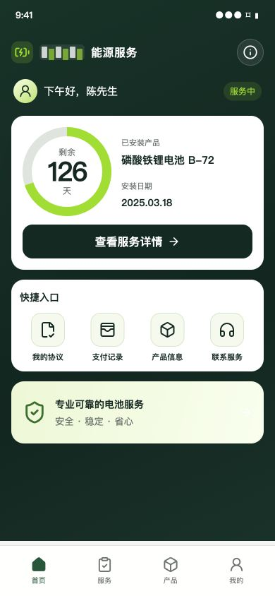
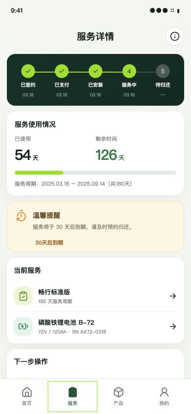
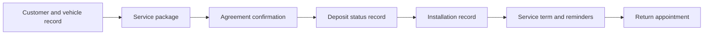

# Vehicle battery service mini program

**客户定制交付 · Authorized anonymized customer delivery**

A customer-facing service journey that connects a vehicle and battery service record with agreements, deposit status, installation, the active service term, reminders and return arrangements.

 

*Published system interfaces with customer identity and business data anonymized. Values shown in the images are not business-performance metrics.*

## The business problem

Customer records, vehicles, agreements, deposit records, installed products and return arrangements were distributed across separate touchpoints. Customers needed to understand their current service status, while service staff needed to follow the same operational progress.

## The connected lifecycle

## What is captured at each stage

| Stage | Information connected | Why it matters |
|---|---|---|
| Registration | Customer and vehicle profile | Keep the service attached to the correct customer/vehicle |
| Package and agreement | Selected service and agreement status | Make the agreed service understandable |
| Deposit | Deposit record/status | Make its status visible within the service record |
| Installation | Product and installation information | Relate installed equipment to the active service |
| Active service | Start/end dates, remaining term and reminders | Give customers a clear view of the current stage |
| Return | Appointment and return arrangements | Continue the same record through the end of service |

The public record documents deposit information and agreement handling. It does not establish a particular payment gateway, settlement provider or electronic-signature vendor, so this page makes no such integration claim.

## Outcome recorded in the case library

The delivered functions organize customer, vehicle, agreement, deposit, installation, service-term and return information into a unified service record. Customers can inspect the current stage, and staff can follow installation, expiry reminders and return handling around the same progress.

## Acceptance questions for a similar project

1. Which customer and vehicle own this active service?
2. Are agreement, deposit and installation states individually visible?
3. How are service dates and reminder eligibility calculated?
4. Can a customer request a return without creating a disconnected service record?
5. Which staff actions require permissions and an audit trail?

These questions define a potential new project's acceptance scope; they are not unpublished test results from the original engagement.

## Evidence and scope

The [published case](https://www.smaroot.tech/cases/details/2648/vehicle-battery-service-mini-program-2025/) is classified as `ANONYMIZED_DELIVERY`, `DELIVERED`, `VERIFIED`, `ANONYMIZED_APPROVED` and `ACCEPTED`. Its public evidence summary references the delivery scope, system interfaces and customer confirmation. This summary does not assert a contracting legal entity, project-start date or production payment integration.

**中文摘要：** 通过同一套小程序记录客户与车辆、套餐、协议、保证金、安装、服务期限、到期提醒和归还预约。公开材料已脱敏，业务结果采用功能与流程层面的定性说明。

[Project index](README.md) · [Contact Edward](https://github.com/smaroot-tech-edward/smaroot-tech-edward/blob/main/CONTACT.md)
