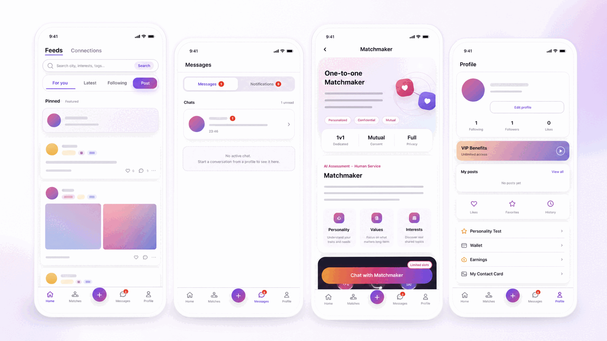
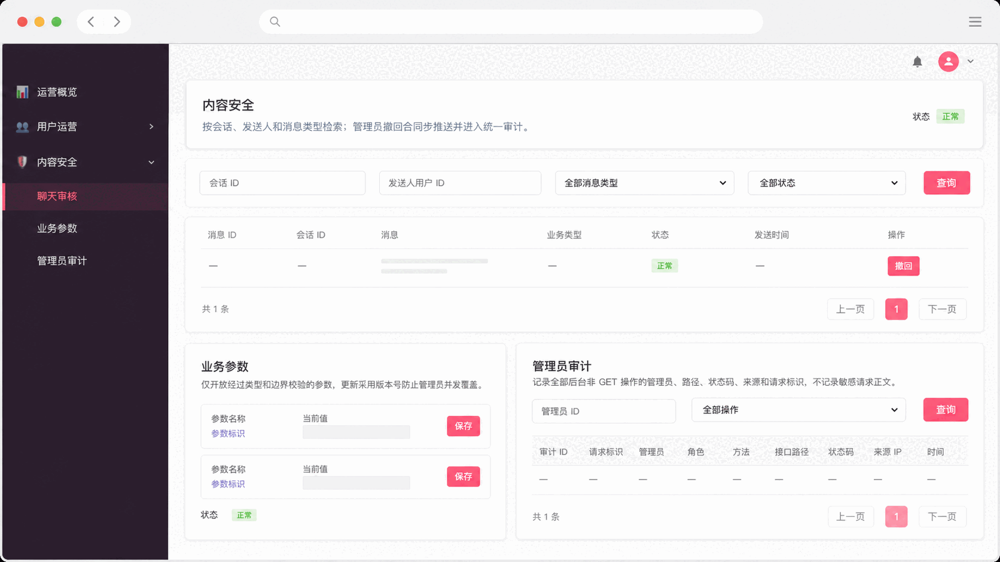

# Community & assisted matching mini program

**客户定制交付 · Authorized anonymized customer delivery**

A connected system for an adult community service: a WeChat mini program for members, a business backend and an operations console for moderation and administration.

*Interfaces reconstructed and anonymized from the actual project UI. They do not expose the original customer brand, member records or private conversations.*

## The business problem

The service needed to connect profile completion, content discovery, social interaction, conversations and one-to-one human-assisted matching. Operators also needed a practical way to moderate content, manage business settings and inspect administrative actions. Treating these as unrelated pages would leave gaps between the member experience and operations.

## What the system connects

| Role | Workflow | Operational purpose |
|---|---|---|
| Adult member | Complete a profile and explore content | Establish context before interaction |
| Member | Interact, open conversations and enter assisted service | Keep the next action within the same product journey |
| Service operator | Handle the assisted-matching service | Connect human service to the user-facing workflow |
| Moderator | Review content and messages through the permitted console | Support governance within the system |
| Administrator | Maintain business parameters and audit operations | Make operational changes traceable |

## Delivered structure

The published delivery record covers a **WeChat mini program, Spring Boot backend and Vue operations console**. The documented stack includes UniApp, Vue 3, MySQL and Redis. The first release entered production use; later iterations continue. The illustrations should not be read as a claim that every later feature is already live.

*Reconstructed, anonymized project UI: moderation, business parameters and administrator audit.*

## Engineering considerations

- **A shared business lifecycle:** user-facing actions and operator work need consistent identifiers and states.
- **Governance alongside interaction:** review and administration are part of the product, rather than an unrelated afterthought.
- **Controlled iteration:** the source record identifies production-compatibility constraints and isolated regression checks as part of ongoing work.
- **Privacy in public evidence:** explain the system through anonymized interface structure and authorized delivery summaries.

## Acceptance questions for a similar project

These are useful scope questions for a new engagement, rather than a claim about unpublished customer acceptance documents:

1. Which member actions require a completed profile or an explicit eligibility rule?
2. Can a member move from content discovery into the intended conversation/service journey?
3. Which roles can review content or change business parameters?
4. Are administrator changes visible in an audit trail?
5. Which existing user journeys must remain compatible during an upgrade?

## Evidence and scope

The [published case](https://www.smaroot.tech/cases/details/2700/anonymized-dating-miniprogram-delivery/) is classified as `ANONYMIZED_DELIVERY`, `VERIFIED`, `ANONYMIZED_APPROVED` and `ACCEPTED`. Its evidence summary references delivery documentation, actual UI, production compatibility and regression records. This page summarizes that public record; it publishes no private source, contracts, conversations or business metrics.

**中文摘要：** 将成年用户资料、内容互动、消息与人工牵线服务，同内容治理、业务参数和管理员审计连接起来。首期已投入生产使用，后续版本持续迭代；公开画面依据实际 UI 脱敏重制。

[Project index](README.md) · [Contact Edward](https://github.com/smaroot-tech-edward/smaroot-tech-edward/blob/main/CONTACT.md)
