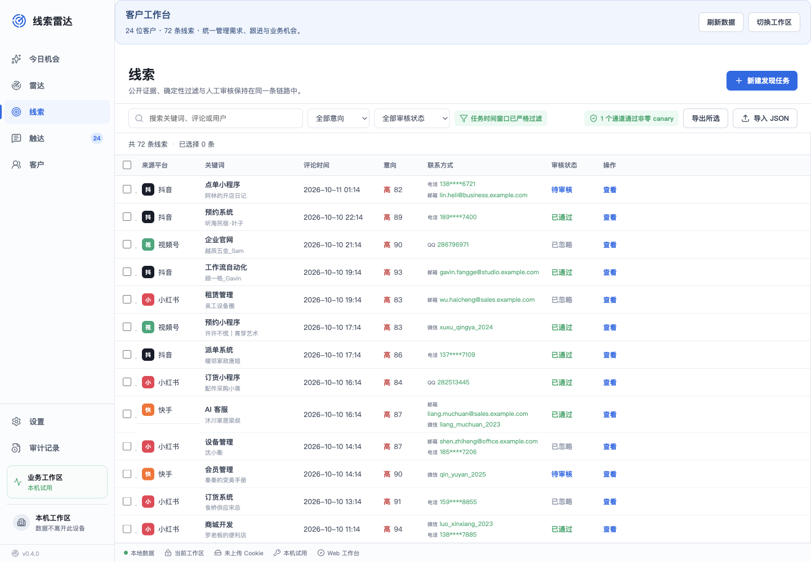

# Lead Radar CRM workbench

**自有业务界面与流程展示 · Smaroot-owned interface study**

A desktop/web workbench that keeps demand review and customer follow-up in a continuous context.

*Demonstration records illustrate filtering, intent levels and review states; contact fields in the presentation are not a directory of real prospects.*

## Business flow

| Step | Interface responsibility |
|---|---|
| Review demand | Keep the source record and business direction visible |
| Filter and assess | Combine intent levels, review status and relevant fields |
| Relate to a customer | Preserve the customer record, owner and conversation context |
| Prepare the next action | Review a draft and arrange follow-up |
| Handover | Export the selected records and retain the review context |

The documented implementation uses React, TypeScript, Electron and SQLite. Public and local checks cover page rendering and interactions such as filtering, notes, customer linkage, draft review and CSV export. The published evidence does not include real platform collection or message-delivery receipts.

## Useful questions for a CRM project

- What makes a demand record ready for human review?
- Which source and consent information must remain attached to the customer?
- How does a new staff owner understand the previous conversation?
- Who approves an outgoing draft, and what constitutes a confirmed next action?

These questions help connect a CRM to the team's actual workflow instead of creating another isolated contact table.

[Public workbench](https://lead-radar.showcase.smaroot.tech/) · [Source case](https://www.smaroot.tech/cases/details/2715/lead-radar-customer-followup-workbench-20260520/)

**中文摘要：** 围绕需求证据、人工审核、客户上下文和跟进安排组织 CRM 工作台；公开画面使用演示数据，展示流程与交互能力。

[Project index](README.md) · [Contact Edward](https://github.com/smaroot-tech-edward/smaroot-tech-edward/blob/main/CONTACT.md)
