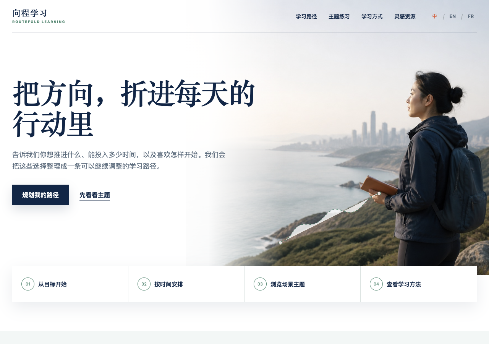

# Multilingual education website

**自有网站与交互展示 · Smaroot-owned website study**

An education-oriented website that turns language selection, learning interests and available study time into a clear starting suggestion.

*Smaroot-owned presentation and original illustrative visual material.*

## The visitor journey

1. Choose Chinese, English or French.
2. Explore a learning theme and goal.
3. Select weekly time and a starting preference.
4. Receive a corresponding starting suggestion.
5. Continue through a consistent responsive navigation structure.

## Engineering detail

The published stack is HTML, CSS and JavaScript with responsive layouts. The pathway result is composed in the browser. The interface does not save or submit the visitor's answers to an institution's business system.

For a related website project, useful acceptance points include language/navigation consistency, preserving the intended interaction across screen sizes, checking each decision branch and making the next action understandable. If a real CRM, course catalog or enrollment system is required, that integration becomes explicit additional scope.

[Public website](https://routefold-learning.showcase.smaroot.tech/) · [Source case](https://www.smaroot.tech/cases/details/2713/routefold-multilingual-pathway-selection-20261003/)

**中文摘要：** 将三语内容、主题导航与目标选择串联起来。该项目展示公司自有网站与交互实现，不代表真实教育机构交付或招生结果。

[Project index](README.md) · [Contact Edward](https://github.com/smaroot-tech-edward/smaroot-tech-edward/blob/main/CONTACT.md)
