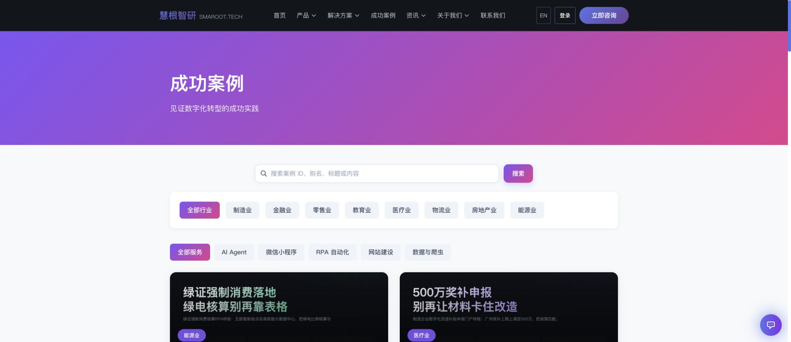
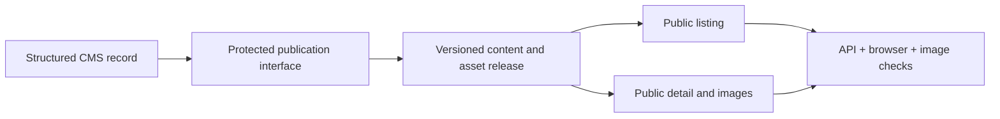

# Content publishing & release verification

**自营生产系统 · Smaroot-operated production workflow**

A CMS and release workflow that keeps structured content, the public listing, detail pages and image assets consistent.

*The public case library interface, shown as part of the self-operated publishing workflow.*

## The consistency problem

A successful content API write does not prove that visitors can see the correct page. A listing can point to a stale detail page, an image path can return the wrong content type, and desktop rendering can hide a mobile layout problem.

## The operating flow

| Layer | What needs to agree |
|---|---|
| CMS/API | Title, summary, classification, body and image references |
| Listing | Correct entry, industry/service filter and destination |
| Detail | Expected text, layout and matching assets |
| Images | Reachable URL, valid image type and useful dimensions |
| Devices | A readable desktop and mobile presentation |

The documented stack includes Nuxt 3, Vue 3, Spring Boot, REST APIs and versioned static-release pipelines.

## Practical delivery lesson

Define acceptance around the visitor's final result: the intended content appears in its listing, the detail page renders the expected body, the images load and the key layouts work. Keep the write receipt and public-page verification as separate evidence.

The [published case](https://www.smaroot.tech/cases/details/2646/smaroot-cms-publish-frontend-verification-20260827/) documents Smaroot's self-operated production chain. The system is visible at [smaroot.tech](https://www.smaroot.tech/). This record concerns the company's own CMS and website, rather than an external customer's commercial results.

**中文摘要：** 后台结构化内容、公开列表、详情正文和图片沿同一条发布链路上线，并从用户实际看到的页面反向完成验收。

[Project index](README.md) · [Contact Edward](https://github.com/smaroot-tech-edward/smaroot-tech-edward/blob/main/CONTACT.md)
