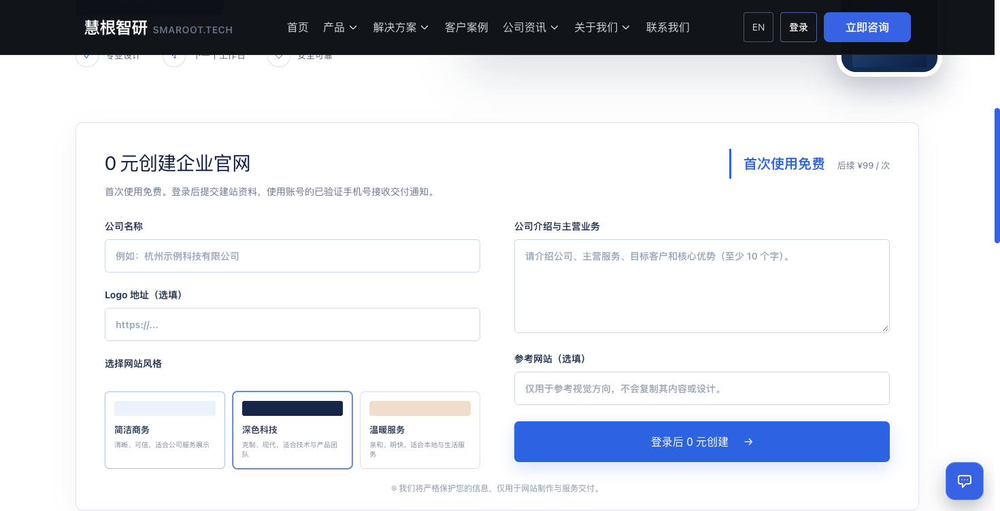

# Website onboarding & service intake

**自营生产系统 · Smaroot-operated production workflow**

A structured application path for a lightweight company website: explain the service, collect company material, choose a visual direction and continue through the account flow.

*The public Smaroot intake page. Its current self-service offer and limits are defined on the original page; custom extensions require their own agreed scope.*

## Problem and workflow

Company introductions, logos and style preferences often arrive separately. A useful intake flow should collect the required business context while making service scope visible before submission.

The production page connects:

1. **Service explanation:** what the lightweight site service includes.
2. **Business material:** company name, introduction and optional logo/reference.
3. **Visual direction:** selectable style choices associated with the request.
4. **Account handoff:** a coherent path through login and the service request.
5. **Request state:** the documented implementation includes duplicate-request handling and order-state management.

## Engineering and acceptance considerations

The documented stack is Nuxt, Vue, TypeScript, Spring Boot and MySQL. For a similar workflow, agree which inputs are mandatory, preserve the chosen style through account handoff, guard against accidental repeated submission and make the next state understandable to the user. These scope questions are more useful than accepting a form while losing its business context.

## What is publicly verifiable

The [live intake page](https://www.smaroot.tech/99-site) and [published production case](https://www.smaroot.tech/cases/details/2718/business-light-site-intake-account-flow-20261027/) show the form, style options and scope explanation. The case records checks against the public page and implementation. This is Smaroot's own operating service, presented separately from external customer deliveries.

**中文摘要：** 把企业资料、视觉选择、登录衔接与服务范围放在一条申请路径中，让后续制作和定制咨询有结构化起点。

[Project index](README.md) · [Contact Edward](https://github.com/smaroot-tech-edward/smaroot-tech-edward/blob/main/CONTACT.md)
